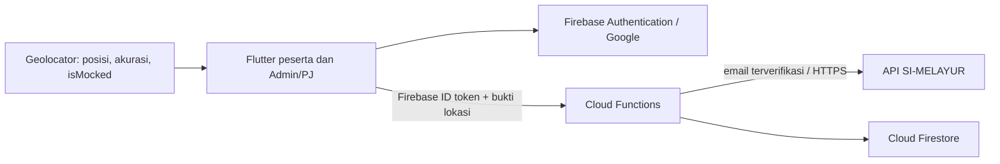

# Penyatuan Flutter dan Firebase

Keputusan 27 Oktober 2026: mengikuti rencana awal Flutter/Dart, Firebase Authentication, Cloud Firestore, Geolocator, dan API SI-MELAYUR. Laravel bukan komponen yang diperlukan untuk menjalankan aplikasi baru.

## Mengapa sebelumnya ada Laravel?

Branch `backend` sudah mengimplementasikan server Laravel dengan Sanctum dan database relasional. Branch `mobile-karina` berisi prototipe Flutter dengan riwayat Git terpisah dan data contoh. Keduanya belum merupakan satu sistem yang terhubung. Tidak ada bukti dalam repository tentang alasan tim memilih Laravel atau bahwa SI-MELAYUR aslinya memakai Laravel.

Laravel bukan teknologi yang salah, tetapi menggabungkannya begitu saja dengan rencana awal akan menghasilkan dua jalur autentikasi dan penyimpanan. Karena pemilik proyek memilih mengikuti rencana awal, server aplikasi baru menggunakan Firebase Cloud Functions. Kode PHP, migrasi, dan tes Laravel dipertahankan di lokasi semula sebagai referensi; jangan deploy atau gunakan endpoint tersebut sebagai bagian alur Firebase.

## Arsitektur yang disatukan



| Bagian | Teknologi | Tanggung jawab |
|---|---|---|
| Aplikasi dan bahasa | Flutter / Dart | Satu aplikasi untuk peserta dan Admin/PJ |
| Login | Firebase Authentication + Google Sign-In | Memastikan identitas akun; email tidak diambil dari input bebas |
| Penyimpanan | Cloud Firestore | Peran pengguna, pengaturan kantor, presensi |
| Lokasi | Geolocator | Koordinat, waktu sampel, akurasi, indikator mock location |
| Validasi area | Perhitungan radius di Cloud Functions | Memeriksa ulang jarak sebelum transaksi disimpan |
| Pemeriksaan lokasi simulasi | Indikator `isMocked` + pemeriksaan server | Menolak sinyal simulasi; bukan jaminan mendeteksi seluruh manipulasi perangkat |
| Integrasi peserta | API SI-MELAYUR melalui HTTPS | Sumber status diterima, keaktifan, dan periode peserta |
| Logika server (tambahan yang memperjelas tabel awal) | Firebase Cloud Functions / JavaScript | Otorisasi, verifikasi API, waktu server, validasi dan pencegahan duplikasi |

Firebase tidak berarti semua keputusan boleh dibuat di ponsel. Cloud Functions diperlukan agar aplikasi yang dimodifikasi tidak dapat langsung menulis status hadir, mengubah radius, atau memberi dirinya peran admin. Admin SDK melewati Firestore Security Rules, sehingga pemeriksaan identitas/peran tetap dilakukan dalam fungsi server.

## Penyatuan kode

- UI dari commit Karina `d632efb` disalin ke `mobile/lib/`, bukan digabung di root yang berisi PHP. Kerangka Android lokal dipertahankan, termasuk `MainActivity.kt` yang tidak ada di commit Karina.
- Kerangka Flutter lokal sebelum penyatuan dicadangkan ke `.local-backups/mobile-before-unification/`; folder ini diabaikan Git.
- Mode demo mempertahankan halaman Karina dengan penanda data contoh. Mode Firebase memakai halaman inti tersambung, tema yang sama, dan tidak mengimpor data contoh untuk data bisnis.
- Tombol keluar peserta/admin demo kini kembali ke login. Semua kondisi lokasi demo bisa dipilih. Koreksi demo memvalidasi jam dan membawa nama peserta terpilih.
- Font memakai font perangkat agar demo tidak memerlukan unduhan font saat dibuka.
- Ukuran minimum tombol diperbaiki agar tombol di dalam baris tidak meminta lebar tak terbatas.

## Alur server yang tersedia

1. `verifyAccess`: Firebase memvalidasi ID token; aplikasi mensyaratkan Google dan email terverifikasi. Peran admin berasal dari dokumen server `users/{uid}`. Peserta diperiksa melalui SI-MELAYUR.
2. `recordAttendance`: memeriksa ulang status/periode peserta untuk masuk maupun pulang; menolak pengaturan kantor kosong, koordinat tidak valid, lokasi usang, akurasi buruk, indikasi mock location, dan posisi di luar radius.
3. Dokumen `users/{uid}/attendances/{YYYY-MM-DD}` menggunakan tanggal Asia/Jakarta. Waktu transaksi dibuat server. Firestore transaction menjaga konsistensi percobaan bersamaan; retry hari/jenis yang sama mengembalikan catatan yang sudah ada. Penolakan lokasi tidak menghabiskan kesempatan presensi.
4. `getMyAttendance`: 31 hari yang memiliki catatan terbaru milik pengguna sendiri.
5. `getAdminAttendance`: admin yang diperiksa ulang di server dapat melihat maksimal 200 catatan hari ini. Batas ini ditampilkan; pagination belum tersedia.

Tidak ada jam masuk/pulang wajib atau klasifikasi terlambat dalam mode tersambung: kebijakan tersebut belum disetujui. Jam 07.30–15.30 dan toleransi 15 menit masih contoh pada UI demo.

## Kontrak API SI-MELAYUR yang diusulkan

Endpoint asli dan dokumentasinya belum tersedia. Adapter ini adalah usulan, bukan klaim bentuk API yang sudah ada. Sesuaikan `functions/src/index.js` setelah pemilik SI-MELAYUR memberikan kontrak nyata.

```http
POST https://HOST-SI-MELAYUR/api/participants/verify
Authorization: Bearer <secret server>
Content-Type: application/json

{"email":"email-dari-firebase-token@example.com"}
```

Respons 200 yang diharapkan:

```json
{
  "participant": {
    "email": "email-dari-firebase-token@example.com",
    "full_name": "Nama Peserta",
    "status": "accepted",
    "is_active": true,
    "start_date": "2026-10-01",
    "end_date": "2026-12-31"
  }
}
```

404 berarti peserta tidak ditemukan. Error jaringan/respons tidak valid menahan akses; tidak ada fallback menerima peserta. Rahasia API berada di Secret Manager, tidak pernah dikirim ke Flutter.

## Data dan izin

- `users/{uid}`: `email`, `role` (`participant` atau `admin`). Admin ditetapkan pengelola melalui akses server/console, bukan formulir ponsel.
- `settings/office`: `active`, `latitude`, `longitude`, `radiusMeters`, `maxAccuracyMeters`. Tidak ada koordinat DKP yang diasumsikan benar atau ditanam sebagai konfigurasi produksi.
- `users/{uid}/attendances/{date}`: `uid`, `date`, `checkIn`, `checkOut`. Sampel berisi waktu UTC server, koordinat, akurasi, indikator mock, dan jarak.
- Firestore dan Storage menolak semua akses langsung klien. Akses bisnis melalui fungsi berautentikasi. Atur IAM pengelola project secara terbatas.

## Status dan batas pengujian

Hasil pemeriksaan lokal setelah penyatuan: `flutter analyze` tanpa masalah, 7 tes widget lulus, 34 tes Node (kebijakan dan gerbang autentikasi) lulus, dan APK Android debug mode demo berhasil dibangun di `mobile/build/app/outputs/flutter-apk/app-debug.apk`. APK ini memakai data contoh dan tidak memerlukan project Firebase.

Pengujian lokal mencakup kebijakan peserta/lokasi dan alur widget demo. Pengujian kebijakan tidak menggantikan pengujian transaksi bersamaan di emulator atau integrasi nyata. Project Firebase tim sudah dibuat, Google Authentication beserta SHA-1 sudah dikonfigurasi, dan Firestore memiliki settings/office dengan active=false. Halaman login Karina terhubung ke alur Firebase; APK tersambung juga berhasil dibangun. Konfigurasi lokal tidak masuk Git. Login pada perangkat, API SI-MELAYUR, transaksi cloud, dan GPS belum diuji end-to-end; Cloud Functions belum dideploy dan endpoint SI-MELAYUR belum tersedia.

Izin/sakit beserta lampiran, koreksi dengan audit persisten, filter/ekspor lengkap, serta profil rinci masih tersedia sebagai UI demo. Fitur tersebut belum ditautkan ke layanan Firebase. Storage sengaja masih tertutup. UI tersambung saat ini mencakup login, presensi, riwayat, dan rekap admin dasar.

Sebelum pilot, selesaikan konfigurasi cloud/API, tetapkan jadwal dan koordinat kantor yang disetujui, uji pada HP Android, lanjutkan fitur admin/izin sesuai prioritas, dan sepakati retensi data lokasi. Sinyal lokasi ponsel dapat dimanipulasi; pemeriksaan server terhadap radius tidak membuktikan koordinat asli.

## Referensi resmi

- [Firebase pada Flutter](https://firebase.google.com/docs/flutter/setup)
- [Google Sign-In](https://firebase.google.com/docs/auth/flutter/federated-auth)
- [Callable Functions dan validasi token](https://firebase.google.com/docs/functions/callable)
- [Protokol callable HTTPS](https://firebase.google.com/docs/functions/callable-reference)
- [Admin SDK dan Security Rules](https://firebase.google.com/docs/firestore/security/rules-fields)
